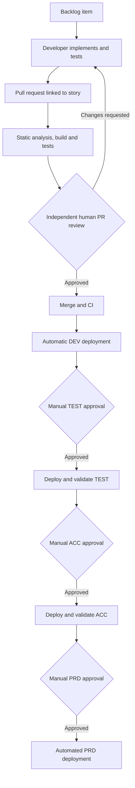
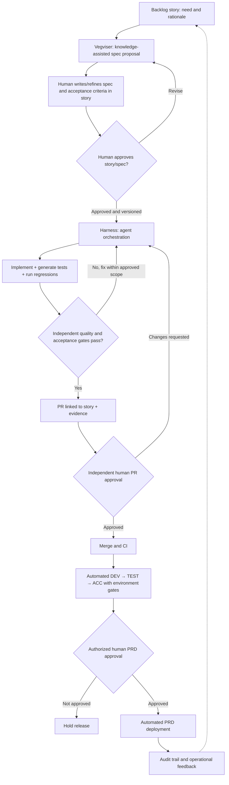

# ADR 0001: Evolution of the Golden Path

- **Status:** Proposed — pending company approval
- **Date:** 2026-10-29
- **Decision owners:** Engineering leadership / Golden Path maintainers (to confirm)
- **Amended by:** ADR 0007 (prototype work, harness-repository review exception, local isolation)
- **Scope:** Company engineering way of working; agent-assisted software delivery
- **Supersedes:** None. Proposes amendments to the current Way-of-Work, not an immediate replacement.
- **References:** `Way-of-Work.pdf` (TeamValue/Bizure), ADR 0002, ADR 0003

## Context

The existing Golden Path defines how TeamValue/Bizure deliver business-critical applications. The process starts from a backlog item, proceeds through implementation and a pull request, and applies quality gates such as static analysis, linked work items, build validation, unit tests, and independent review. CI/CD promotes software through DEV, TEST, ACC, and PRD. The documented process automatically deploys to DEV but requires explicit approvals for TEST, ACC, and PRD.

The existing Way-of-Work is founded on **Segregation of Duties**, **Relentless Automation**, the **Four Eyes Principle**, **Traceability and Auditability**, and **Ownership**. It also places production approval with the Product Owner or delegate, subject to documented emergency exceptions. The process and its principles are not tied to a single DevOps platform, although the current document requires Azure Pipelines for deployments and permits limited GitHub use.

Agent-assisted development can accelerate delivery, but unconstrained adoption can amplify inconsistencies, conceal knowledge gaps, weaken testing, and make changes difficult to audit. The goal is to make a consistent, verifiable minimum engineering standard attainable across teams and experience levels, not to claim that an agent replaces senior engineering judgment.

## Decision

**Evolve the Golden Path into a human-controlled, agent-assisted SDLC.** Preserve the current governance principles while moving repetitive implementation, validation, and evidence collection into a reusable engineering harness.

1. **Backlog item remains the system of record.** A story/work item holds the approved specification or an explicitly versioned, linked specification artifact, acceptance criteria, rationale, and traceability links. The backlog is not replaced by a chatbot conversation or ephemeral agent context.
2. **Vegviser assists with knowledge and specification preparation.** It may use company knowledge and patterns to propose or refine a specification; it does not confer approval.
3. **Human acceptance sits between Vegviser and harness execution.** A human writes, reviews, or amends the specification in the story and expressly approves it before autonomous implementation begins.
4. **The harness implements the approved specification.** It orchestrates agent-assisted planning, implementation, tests, regression checks, policy compliance, and evidence collection. The agent may iteratively fix failing checks but may not weaken acceptance criteria or bypass controls.
5. **The team owns agent-produced work.** Named humans are still accountable for the story, PR review, and release decisions. Team ownership does not remove the requirement for a reviewer independent of the implementer/operator.
6. **Pull requests require human approval.** Automated checks supplement rather than replace independent review; post-approval code changes require reassessment under existing policy.
7. **DEV, TEST, and ACC promotion should become automated** when defined quality, functional, security, and environment-specific gates pass. This is a **proposed change** to the existing Way-of-Work, which currently requires explicit TEST and ACC approvals; it must be ratified before deployment policy is changed.
8. **PRD deployment continues to require an explicit manual approval** by the authorized Product Owner or delegate (including applicable emergency exceptions). After approval, the deployment itself should be automated.
9. **Regression acceptance is hybrid.** Approved business acceptance criteria are independent of the implementing agent and protected from unilateral modification. The agent may add unit, integration, and regression tests, but cannot redefine the approved business outcome to make its result pass.
10. **Traceability is mandatory:** story/specification version → execution record → code/commit → tests/evidence → PR/reviewer → build/release → production approval and deployment.

## Current Golden Path

## Proposed Golden Path

**Note:** This diagram shows the intended future process, not the current approved deployment permissions. The human checkpoint is deliberately **after Vegviser and before the harness**. The story remains the authoritative record, including human-authored or human-edited specification text.

## Rationale

- **Speed:** remove repeated manual execution and handoffs when checks can produce reliable evidence.
- **Consistency:** apply the same company-defined conventions and architectural rules independent of agent, developer experience, or project.
- **Quality:** move verification earlier, require regression checks, and preserve independent review and release approval.
- **Knowledge transfer:** encode standards and examples in reusable, traceable mechanisms rather than relying solely on individual experience.
- **Control:** automate implementation and verification without granting the implementing agent authority over the business requirement or production release.

## Considered alternatives

| Alternative | Reason not selected |
| --- | --- |
| Retain the current manual process unchanged | Does not sufficiently address throughput, consistency, and reusable knowledge. |
| Let agents implement from unapproved prompts | Weakens requirement traceability and makes scope changes hard to audit. |
| Fully autonomous PR merge and production release | Conflicts with the current ownership, independent review, and PRD approval principles. |
| Treat generated tests as the only definition of correctness | Agents can validate their own misunderstandings; independent acceptance criteria are required. |

## Consequences and tradeoffs

**Positive**

- Engineers focus more on requirements, design judgments, reviews, and exceptions.
- Junior engineers can leverage an explicit, verified minimum standard while remaining accountable for understanding results.
- More complete links between intent, implementation, test evidence, and deployment.
- Faster promotion to TEST/ACC **if** automated gates prove trustworthy and policy changes are approved.

**Negative / risks**

- Quality becomes dependent on the clarity and review of stories/specifications.
- Agent-generated tests may encode the same mistaken assumptions as the implementation; independent business checks remain necessary.
- Harness policies can overconstrain valid solutions; exceptions and appeals require governance.
- Automated TEST/ACC promotion changes existing approval controls and needs explicit agreement from process owners.
- Human reviewers may experience review overload if evidence is noisy; reports should prioritize risk and explainability.
- Team ownership can blur individual responsibilities unless a responsible story owner, reviewer, and release approver are recorded.

## Implementation implications

- Extend backlog templates with specification, acceptance criteria, nonfunctional requirements, constraints, and links to evidence.
- Use a distinct human approval signal/versioned baseline before the harness can implement.
- Make the harness produce a structured PR evidence report: requirement mapping, test results, architecture checks, exceptions, and known uncertainties.
- Retain existing PR policies, build gates, static analysis, and deployment approval enforcement.
- Introduce TEST/ACC automatic promotion only after the Way-of-Work and relevant pipeline approvals are explicitly amended.
- Require appropriate credential and execution isolation for agent runs. For local work the read-only identity is the boundary, and sandboxing is an accepted risk (ADR 0007 decision 8).
- There is no prototype mode. Agent-written code in a project repository is production code. Useful exploration done elsewhere starts again at the approved-spec step (ADR 0007 decision 7).
- The independent-review requirement (item 5) applies to product repositories. The harness repository has a documented exception while it has a single maintainer (ADR 0007 decision 2).
- Define measurable indicators: cycle time, escaped defects, regression detection, review effort, compliance drift, and traceability coverage.

## Open decisions / ratification gates

1. Who is the accountable story owner within the collectively owning team, and how is that recorded?
   - **Answer:** Business and developer together, who give the commitment. Recorded in the backlog tool in use (Azure DevOps, GitHub Issues or Jira).
2. Which objective gates are mandatory before automatic TEST/ACC promotion, and who may grant exceptions?
   - **Answer:** Depends on the customer: TEST and ACC may or may not be gated. DEV is for the developers and is not gated.
3. What constitutes a versioned, human-approved specification in Azure Boards / future GitHub workflows?
   - **Answer:** The specification is registered in the backlog tool and the docs in the repo are kept up to date. The combination keeps decisions traceable through time.
4. Does company policy permit exceptional self-review/hotfix procedures to continue unchanged for agent-authored changes?
   - **Answer:** No. A human always stays in control for PRD.
5. How are acceptance tests independently maintained when requirements change after harness execution begins?
   - **Answer:** Acceptance tests live in a separate repo. When requirements change, the regression/acceptance scenarios change with them.

## Decision review triggers

Revisit this ADR after the first greenfield and multiple brownfield evaluations, after a production incident attributable to the agentic workflow, or before relaxing any human approval control.
