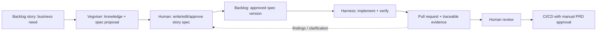

# ADR 0003: Knowledge-to-Code Boundary (Vegviser and Harness)

- **Status:** Approved
- **Approved by:** joeghanoe, 2026-11-01T20:15:44Z
- **Date:** 2026-10-29
- **Scope:** Responsibility boundaries between backlog, Vegviser, human approvers, and the harness
- **Depends on:** ADR 0001, ADR 0002

## Context

Vegviser is intended to help engineers use organizational knowledge to prepare specifications. The harness implements a specification. These responsibilities must not collapse into one opaque agent workflow. Requirements and their rationale should remain traceable in the existing backlog system.

## Decision

The **backlog story/work item is the system of record** for business needs, human-approved specifications, and acceptance criteria. Vegviser is a knowledge assistant that can propose specification content. A human writes, edits, and explicitly approves the story/specification **after Vegviser and before harness execution**. The harness consumes the approved version and produces implementation and verification evidence back-linked to that story.

### Proposed information contract

| Artifact | Owner / authority | Minimum contents |
| --- | --- | --- |
| Story / backlog item | Team / designated story owner | Why, business outcome, constraints, linked discussion |
| Proposed specification | Vegviser-assisted human workflow | Scope, behaviors, relevant company principles, assumptions |
| Approved specification | Human approver, stored/versioned in or linked from story | Acceptance criteria, nonfunctional constraints, approval/version |
| Implementation evidence | Harness | Commit/diff, tests, evaluation results, deviations, tool trace |
| PR approval | Independent human reviewer | Review decision and comments |
| Production release authorization | Product Owner / delegate | Approval tied to tested release/version |

## Rationale

This boundary keeps knowledge generation, business authorization, implementation, and governance distinguishable. It prevents the implementing agent from silently redefining the requested outcome and keeps traceability aligned with the existing Golden Path.

## Alternatives

- **Vegviser directly triggers the harness on generated specs:** faster, but removes the mandatory human interpretation/approval boundary.
- **Store the only authoritative spec inside the harness repository:** simplifies developer tooling but weakens backlog-centered business traceability.
- **Story as authority, with versioned external attachments linked to it (proposed):** supports large specifications while keeping the backlog authoritative.

## Consequences and open questions

- Need a definition of spec approval (status, field, comment, or artifact signature).
  - **Answer:** Answered in ADR 0001 open decision 3: the specification is registered in the backlog tool and the repo docs are kept up to date.
- Need a safe sync strategy when an approved story changes during an agent run.
  - **Answer:** If it changes, the user tells the agent.
- Need agreement on whether Vegviser writes into backlog directly or produces a draft the human copies/accepts.
  - **Answer:** Vegviser advises; the user makes the decisions. It produces a draft, not backlog writes.
- Need a clarification loop: the harness must stop or request review if the specification is materially ambiguous.
  - **Answer:** The agent must stop when it needs a decision it cannot make without assumptions.
- Need to define how nonfunctional requirements and architectural constraints are injected and versioned.
  - **Answer:** They must be specified in the spec.
