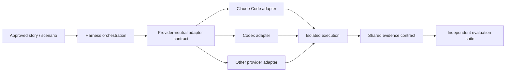

# ADR 0006: Agent and Model Independence

- **Status:** Draft — requires team review
- **Date:** 2026-10-29
- **Scope:** Provider-neutral harness contracts, adapters, benchmarking and authentication boundaries
- **Amended by:** ADR 0007 (per-run resource fields)
- **Depends on:** ADR 0002, ADR 0004, ADR 0005

## Context

The initial engineering workflow uses Claude Code, but the harness is intended to support Codex, Gemini and other compatible agents/models, including lower-cost alternatives. Company engineering standards should survive a provider change. A claim that one model is better than another is meaningful only if task definitions, evidence, permissions and evaluation remain comparable. The current budget favors sequential local runs, potentially using Rancher Desktop; supported CLI subscription authentication should be usable where provider policy and tooling permit, without requiring API keys merely to support an adapter.

## Proposed decision (not yet ratified)

**Make specifications, rules, evaluation criteria and result formats provider-neutral. Place provider-specific execution behind replaceable adapters.**

1. Define a shared scenario input contract: approved story/spec reference, starting repository state, permissions, tools, limits and expected evidence.
2. Define shared output artifacts: code diff, tests and logs, agent/tool trace, failures, provenance and measured resource consumption.
3. Keep model-specific CLI invocation, login/session handling, command formatting and transcript parsing inside the provider adapter.
4. Require common authorization and policy enforcement **outside** the agent's own prompts; adapters must not bypass these boundaries.
5. Compare either **models under materially equivalent harness conditions** or explicitly label tests as **model + adapter/harness stack** comparisons when execution capabilities differ.
6. Prefer sequential isolated runs and replay of captured artifacts to minimize cost; concurrency is not necessary for correctness.
7. Track versioned model identifiers where possible, provider usage limits, context differences and unavailable metrics. Mark unknown financial cost as unknown, not zero. Every adapter writes `input_tokens`, `cached_input_tokens`, `output_tokens`, `cost` (with `cost_reason`) and `wall_seconds` per run, with `null` for what the engine does not report (ADR 0007 decision 3).
8. Never assume that a subscription login grants unlimited automation rights; confirm support and terms per provider.

## Architecture sketch

## Alternatives considered

| Option | Assessment |
|---|---|
| Standardize exclusively on one agent | Simple initial setup; vendor dependence and limited ability to optimize cost |
| Force identical execution internals across all providers | Unnecessarily brittle where provider tools differ |
| Provider-neutral contracts with thin adapters (**proposed**) | Portable standards; adapters still require testing and careful comparability disclosures |

## Consequences

- Requires adapter conformance tests and stable schema/versioning for scenario/results.
- Provider-specific capabilities may offer legitimate advantages; benchmark reporting must distinguish them from inherent model quality.
- Local container isolation is a separate execution concern, not an inherent requirement of a particular model or a commitment to Rancher Desktop.
- Authentication is an explicit boundary; do not copy personal credential directories into an unrestricted candidate workspace.
- Benchmarking can begin with current subscription-backed usage where supported, but quantitative cost estimates may remain incomplete.

## Open questions

1. Is portability across agent CLIs sufficient, or must direct API/in-process model execution also be supported?
   - **Answer:** Portability is enough. In practice GitHub Copilot will be used; Claude Code and Codex may be used too.
2. Which minimal capabilities must an adapter expose before it is considered supported?
   - **Vegviser guidance (AI Agent Operating Standard, Tool Adapter Contract; to confirm):** an adapter must load the shared instructions through native discovery, a thin adapter file or injected context, and verification must show the content was actually loaded, not just that the file exists. A tool that can do none of these is not supported.
3. How will model-specific skills, tools or context-size differences be reported and normalized?
   - **Vegviser guidance (AI Agent Operating Standard and AI Governance; to confirm):** register each model's owner, version, capabilities, limitations and cost, and treat a model update as an architectural change. Cross-tool checks compare decisions and authority use, not wording, and record the tool and version, evidence that instructions loaded, and unsupported capabilities.
4. Which provider authentication flows are supported for local interactive versus unattended CI use?
   - **Answer:** Managed Identity only, preferably.
5. What is the threshold for adopting a cheaper model: equal hard-gate compliance, minimum task success, maximum human review effort, or another criterion?
   - **Answer:** Task success and quality.

## Acceptance criteria for ratification

- At least two supported agent adapters can run the same scenario schema and emit the same evidence schema.
- Eval definitions contain no provider-specific prompts or output assumptions unless explicitly scoped.
- The benchmark report identifies adapter, model, harness and evaluator versions, plus material execution differences.
- Policy enforcement remains effective across adapters.
